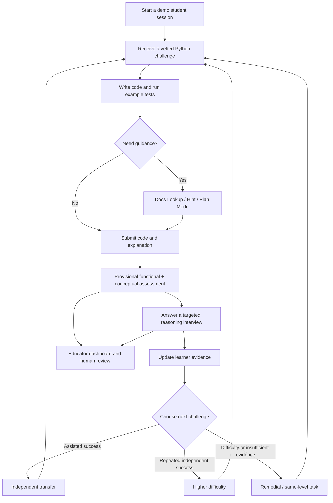
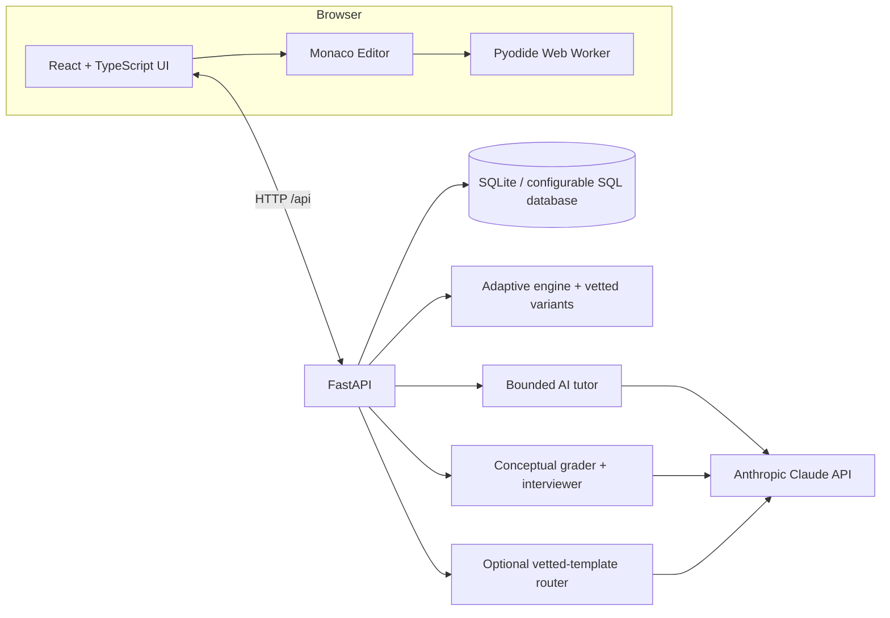

<div align="center">

# COGNIT.

### Think Deeper. Code Smarter.

**An adaptive Python learning lab that looks beyond passing tests to examine the reasoning behind a solution.**

[](https://imperialaihack-production.up.railway.app/student)
[](https://www.python.org/)
[](https://react.dev/)
[](https://fastapi.tiangolo.com/)
[](https://www.typescriptlang.org/)
[](#hackathon)

**[Try the student experience](https://imperialaihack-production.up.railway.app/student)** · **[Educator dashboard](https://imperialaihack-production.up.railway.app/teacher)** · **[How it works](#how-cognit-works)** · **[Run locally](#getting-started)**

</div>

---

## The problem

A program can pass its test cases without demonstrating that its author understands *why* it works. In an era of readily available AI-generated code, educators need more than a binary correct/incorrect result, while students still benefit from responsible access to learning support.

**COGNIT separates evidence of execution from evidence of understanding.** It combines runnable Python challenges, constrained AI tutoring, explanation-based assessment, a targeted conceptual follow-up, and independent transfer problems. The aim is to support learning and give educators richer evidence—not to claim that AI assistance can be perfectly detected or that mastery has been scientifically validated.

## At a glance

| Experience | What COGNIT provides |
| --- | --- |
| **Write and run Python** | In-browser Monaco editor, example tests, execution output, and readable errors |
| **Explain your reasoning** | Structured conceptual grading, distinct from functional correctness |
| **Defend your understanding** | A targeted follow-up question about an edge case, prediction, or counterexample |
| **Learn with guardrails** | Approved documentation lookup, progressive hints, and student-authored Plan Mode |
| **Practise adaptively** | Vetted question variants, independent transfer tasks, and rule-based difficulty progression |
| **See the evidence** | Provisional score breakdowns, assistance history, and teacher review with an audit trail |
| **Explore a distinctive interface** | Dark developer-inspired UI, animated binary rain, and a skill constellation |

> **Prototype status:** This is a hackathon research/demo application. AI-powered features require a valid server-side Anthropic configuration. In offline mode, grading can be flagged for teacher review rather than producing an invented AI score. Do not use this system for high-stakes assessment or real student records.

## How COGNIT works



### 1. Solve

Students work on curated Python problems using a Monaco-based editor. **Run** executes public example tests in a browser-side Pyodide Web Worker. The interface displays test outcomes, stdout, exceptions, and timeouts. Keyboard shortcuts include **Ctrl/Cmd + Enter** to run and **Ctrl/Cmd + Shift + Enter** to submit.

### 2. Understand

A submission includes the code **and** a written explanation. The conceptual grader evaluates the explanation separately using a structured 30-point rubric. COGNIT also asks a short follow-up reasoning question, which provides an additional, separately recorded signal of understanding.

### 3. Transfer

After assisted success, COGNIT can present a related but different vetted challenge to see whether the student can apply the concept independently. The next-question engine also supports same-level practice, remediation, and advancement after qualifying independent successes.

### 4. Review

Educators can inspect attempt histories, reasoning, assistance records, score breakdowns, conceptual interviews, and progression. They can approve or override a conceptual score with a required note; reviews are retained in an append-only audit history.

## Features in detail

### Adaptive questions with validated variants

- Questions are generated from **approved, parameterised Python templates** rather than unrestricted model-written executable tasks.
- The bank covers **loops, hashing, and basic complexity**, including paired transfer tasks.
- A deterministic variant generator creates problem instances and checks them against reference tests.
- The adaptive engine considers assistance, performance, difficulty, and independent-transfer evidence.
- An **optional Claude-based question router** selects only among approved templates; invalid, unavailable, or disabled model output falls back to deterministic selection.
- The implementation includes guardrails against unvetted template selection and repeated questions.

**Important distinction:** “Dynamic” means adaptive selection and validated variation. It does **not** mean unlimited free-form AI generation of arbitrary coding questions.

### AI assistance without handing over the answer

| Mode | Behaviour |
| --- | --- |
| **Reference / Lookup** | Approved Python documentation and source-oriented explanations |
| **Hint** | Progressive conceptual hints, gated by an earlier attempt |
| **Plan Mode** | Feedback on a student-written approach; encourages reasoning without supplying a complete solution |

Hint and Plan usage are logged as assistance; ordinary documentation lookup is not treated as equivalent to receiving a solution. The tutor is designed to refuse direct-answer and answer-equivalent requests, although no prompt-based protection is infallible.

### Multi-signal assessment

| Evidence | Scale | Meaning |
| --- | ---: | --- |
| Browser example-test performance | **0–70** | Provisional functional correctness |
| Written conceptual explanation | **0–30** | Core idea, complexity, and edge-case reasoning |
| Conceptual follow-up interview | **0–15, separately recorded** | Additional reasoning evidence; not silently added to the 100-point total |
| Independent transfer | Task outcomes | Evidence of applying a concept without the same assistance |
| Assistance events | Contextual log | Helps interpret performance; not a stand-alone cheating indicator |

The **30-point explanation rubric** comprises:

- **15 points:** Core algorithmic understanding
- **10 points:** Complexity and trade-offs
- **5 points:** Edge-case reasoning

Scores are provisional and may require human review. Difficulty weighting is a prototype scoring convention, not an empirically calibrated ability model.

### Educator workspace

The `/teacher` route provides a demo-oriented educator interface for reviewing session evidence, including attempt details, assisted-versus-independent comparisons, mastery indicators, and review flags. The backend also exposes a session roster endpoint. **The teacher interface is not production-authenticated; use synthetic data only.**

### Design and interaction

COGNIT's frontend includes a polished dark theme, violet and mint accents, a responsive student workspace, an **animated binary-rain canvas**, and a **skill constellation** component. The binary effect supports pointer-responsive movement, a landing-page transition, and reduced-motion handling. These visual elements complement the learning workflow rather than replacing it.

## Architecture



**Trust boundary:** Python code runs in the student's browser, not in the FastAPI server. Browser-reported test results are treated as **untrusted demonstration evidence**. The teacher review layer is intended to keep humans involved in ambiguous assessments.

## Tech stack

| Layer | Technologies |
| --- | --- |
| Frontend | React 19, TypeScript, Vite 8, Tailwind CSS 4, React Router |
| Coding editor | Monaco Editor |
| Python execution | Pyodide in a Web Worker |
| Backend | Python, FastAPI, Pydantic, SQLAlchemy |
| AI services | Anthropic Claude API (configurable models), dedicated tutoring, grading, interviewing and routing modules |
| Question selection | Deterministic vetted templates, adaptive rules, optional bounded LLM routing |
| Persistence | SQLite by default; SQLAlchemy database URL configuration |
| Deployment | Multi-stage Docker build; single-origin React + FastAPI service on Railway |
| Quality checks | pytest, integration smoke scripts, oxlint, frontend build, GitHub Actions |

## Repository structure

```text
ImperialAIHack--main/
├── frontend/
│   ├── src/
│   │   ├── pages/          # Landing, student, and teacher pages
│   │   ├── components/     # Editor, tutor, results, binary rain, skill graph
│   │   ├── student/        # Student workspace and local draft handling
│   │   ├── teacher/        # Attempt details and review form
│   │   ├── runner/         # Pyodide worker and Python test harness
│   │   ├── api/            # HTTP client
│   │   └── types/          # Frontend contracts
│   └── package.json
├── backend/
│   ├── app/
│   │   ├── routes/         # Sessions, attempts, assist, next, probes, teacher
│   │   ├── db/             # SQLAlchemy models and persistence
│   │   ├── data/           # Vetted question bank
│   │   └── scoring.py
│   ├── scripts/            # Smoke tests and question-bank validation
│   └── requirements.txt
├── cognit_ai/
│   ├── adapt.py            # Learner state and progression
│   ├── question_variants.py
│   ├── question_router.py
│   ├── tutor_service.py
│   ├── grader_service.py
│   ├── concept_probes.py
│   └── contracts.py
├── contracts/              # Shared backend data models
├── tests/                  # Unit and integration-oriented tests
├── evals/                  # Grading and adversarial evaluations
├── docs/                   # Deployment and assessment design notes
├── Dockerfile              # Single-service production build
├── requirements.txt
└── MASTER_PLAN.md
```

## Getting started

### Prerequisites

- **Python 3.11+**
- **Node.js 24+** and npm
- Internet access for the Monaco and Pyodide CDN resources
- An Anthropic API key **only if** you want live model-backed tutoring and grading

### Option A — Run the complete application on one local URL

From the repository root:

```bash
python -m pip install -r backend/requirements.txt -r requirements.txt
cd frontend
npm install
npm run build
cd ..
python -m uvicorn backend.app.main:app --host 0.0.0.0 --port 8000
```

Open:

- **Student:** http://localhost:8000/student
- **Educator:** http://localhost:8000/teacher
- **API documentation:** http://localhost:8000/docs
- **Health:** http://localhost:8000/health

### Option B — Develop the frontend with hot reload

In terminal 1, from the repository root:

```bash
python -m uvicorn backend.app.main:app --reload --port 8000
```

In terminal 2:

```bash
cd frontend
npm install
npm run dev
```

Open **http://localhost:5173**. Vite proxies `/api` and `/health` to the local backend. When frontend and backend share an origin, the frontend API base URL can remain empty.

### Environment variables

Use the supplied `backend/.env.example` and `frontend/.env.example` as references. Create a private `backend/.env` when needed; **never commit it**.

| Variable | Purpose |
| --- | --- |
| `ANTHROPIC_API_KEY` | Server-side key for live Claude calls |
| `COGNIT_AI_ENABLED` | Enables/disables model-backed AI services |
| `COGNIT_TUTOR_MODEL` | Configurable tutor model |
| `COGNIT_GRADER_MODEL` | Configurable conceptual grader model |
| `COGNIT_PROBE_MODEL` | Configurable conceptual interview / routing model |
| `COGNIT_DYNAMIC_ROUTER_ENABLED` | Enables optional AI selection among vetted question templates |
| `DATABASE_URL` | Database connection; empty uses local SQLite |
| `ALLOWED_ORIGINS` | Comma-separated allowed frontend origins for CORS |
| `VITE_API_BASE_URL` | Optional frontend backend URL when deployed separately |

For a reliable no-key demo, configure:

```dotenv
COGNIT_AI_ENABLED=false
```

In that mode, AI-dependent grades may be recorded as **provisional / requiring review** rather than being fabricated. Model identifiers in example environment files are configurable values; verify availability in your own Anthropic account before enabling them.

> **Security:** Keep API keys in private server/hosting environment variables. Do not enter them into the student UI or commit them to Git. Rotate any credential that may have been exposed.

## API overview

All application API responses follow an envelope shaped like `{ "ok": true, "data": { ... } }` or `{ "ok": false, "error": { "code": "...", "message": "..." } }`.

| Method | Endpoint | Purpose |
| --- | --- | --- |
| `GET` | `/health` | Health check |
| `POST` | `/api/session/start` | Create a student session and return the first question |
| `GET` | `/api/session/{session_id}` | Restore session progress |
| `POST` | `/api/attempt` | Submit code, explanation, test evidence, and assistance log |
| `POST` | `/api/assist` | Request Lookup, Hint, or Plan support |
| `POST` | `/api/probe/start` | Create or retrieve a conceptual follow-up |
| `POST` | `/api/probe/answer` | Submit the follow-up answer |
| `POST` | `/api/next` | Request the next adaptive challenge |
| `GET` | `/api/teacher/sessions` | Demo session roster |
| `GET` | `/api/teacher/session/{session_id}` | Educator session evidence |
| `POST` | `/api/teacher/review` | Review or override a conceptual score |

FastAPI also exposes interactive OpenAPI documentation at `/docs`.

## Testing and validation

From the repository root:

```bash
python backend/scripts/validate_bank.py
python backend/scripts/smoke_e2e.py
python backend/scripts/smoke_persistence.py
python backend/scripts/smoke_failures.py
python -m pytest -q tests --ignore=tests/test_live_tutor.py
```

For frontend checks:

```bash
cd frontend
npm run lint
npm run build
```

The repository also contains targeted tests for contracts, adaptive selection, question variants, conceptual probes, scoring integrity, public roster/quota behaviour, and a hosted single-page application. The `evals/` directory includes adversarial and grading evaluation scripts. **The presence of tests is not a claim of a particular pass rate in every deployment**; run them in your environment and report observed results with sample sizes.

## Deployment

The root [`Dockerfile`](Dockerfile) builds the React frontend and packages it with FastAPI, so both UI and API can be served from **one Railway service**. The provided deployment guide explains GitHub-connected builds, health checks, and persistent SQLite storage.

- **Live student app:** https://imperialaihack-production.up.railway.app/student
- **Educator route:** https://imperialaihack-production.up.railway.app/teacher
- **Health endpoint:** https://imperialaihack-production.up.railway.app/health
- **Deployment guide:** [`docs/TEAM_DEPLOY.md`](docs/TEAM_DEPLOY.md)

For persistence across restarts, mount a Railway volume at `/data` and set `DATABASE_URL=sqlite:////data/cognit.db` as documented. Without persistent storage, local container data may be lost on redeployment. Configure AI-related variables privately in Railway if live Claude features are needed.

## Responsible AI, security, and limitations

COGNIT is designed to **support assessment and learning**, not to replace a qualified educator's judgement.

1. **Not an exam-secure sandbox.** Python executes in browser-side Pyodide. Import restrictions and worker timeouts are best-effort prototype protections.
2. **Untrusted execution evidence.** Browser-submitted test results can be manipulated; the backend does not independently re-run student code in a trusted assessment environment.
3. **Provisional AI grading.** Language-model grading may be incorrect, inconsistent, or unavailable. Low-confidence and ambiguous cases require human review.
4. **Limited question coverage.** The question bank uses a small set of vetted templates. Optional model routing is constrained to these approved choices.
5. **No validated mastery measurement.** Skill indicators, transfer gaps, and difficulty weights are educational heuristics, not psychometrically validated measures or cheating detectors.
6. **Demo access only.** The teacher-facing endpoints are not a production authentication/authorisation system. Use synthetic aliases and data; do not upload real student records.
7. **External dependencies.** Live AI calls incur provider cost and require valid credentials; Monaco and Pyodide rely on CDN availability.

See [`docs/CONCEPTUAL_ASSESSMENT.md`](docs/CONCEPTUAL_ASSESSMENT.md) for a deeper discussion of the evidence model and limitations.

## Future directions

- Secure, server-isolated code execution and trusted hidden tests
- Production authentication and role-based access control
- Larger educator-vetted problem bank and richer skill coverage
- Calibrated assessment studies against human-marked work
- More detailed longitudinal learning analytics
- Improved accessibility, usability testing, and production hardening

## Hackathon

Created for the **Imperial AI Hackathon 2026**, **Reply Challenge: AI on Campus**.

| Area | Team ownership |
| --- | --- |
| Product direction, problem bank, evaluation, integration and submission | **Ahmed** |
| AI/ML: tutoring, conceptual grading, adaptive learning and vetted question variants | **Shreya** |
| FastAPI backend, persistence, endpoints and execution integration | **Aalia** |
| React frontend, coding experience and demo video | **DS** |

The team's master execution plan is available in [`MASTER_PLAN.md`](MASTER_PLAN.md). Roles above describe assigned ownership; the repository is the source of truth for the delivered implementation.

## Acknowledgements

Built using open-source tools and libraries including [React](https://react.dev/), [FastAPI](https://fastapi.tiangolo.com/), [Monaco Editor](https://microsoft.github.io/monaco-editor/), [Pyodide](https://pyodide.org/), and [Tailwind CSS](https://tailwindcss.com/), with optional model services from [Anthropic](https://www.anthropic.com/).

---

<div align="center">

**COGNIT — Intelligence is a process.**

*Solve. Understand. Transfer. Master.*

[Launch COGNIT](https://imperialaihack-production.up.railway.app/student)

</div>
